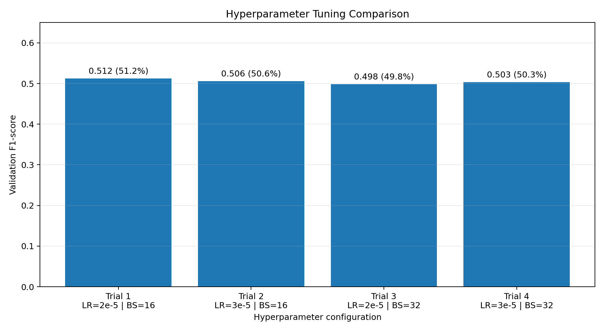

# Civil Comments Toxicity Detector

**Student:** Md. Jahid Gazi  
**Student ID:** 1000128068  
**Institution / Programme:** BRAC University — SICIP  
**Assignment:** Assignment 03 — Transfer Learning, Fine-Tuning, Hyperparameter Tuning, and Interpretability  
**Model:** `bert-base-uncased`  
**Dataset:** Google Civil Comments

> **Reporting note:** This report presents the model configuration, evaluation metrics, hyperparameter comparison, example predictions, and interpretability discussion for the project.

## 1. Objective

The objective is to build a binary text classifier that identifies a comment as **Toxic** or **Not toxic**. The project demonstrates transfer learning with a frozen BERT feature extractor, end-to-end fine-tuning, hyperparameter tuning, evaluation, real-world example predictions, and SHAP-based local interpretability.

## 2. Dataset and preprocessing

- **Dataset:** [Google Civil Comments](https://huggingface.co/datasets/google/civil_comments).
- **Input text field:** `text`.
- **Original target:** `toxicity`, a continuous score between 0 and 1.
- **Binary label rule:** `toxicity >= 0.5` is mapped to **Toxic (1)**; a score below 0.5 is mapped to **Not toxic (0)**.
- **Official splits:** train, validation, and test are kept separate. The validation split is used for model selection and tuning; the test split is reserved for final evaluation.
- **Dataset size in the published dataset card:** 1,804,874 training rows, 97,320 validation rows, and 97,320 test rows. The notebook streams the official splits and creates local Parquet cache files in batches of 5,000 rows.
- **Tokenizer:** `bert-base-uncased` tokenizer.
- **Maximum sequence length:** 128 tokens, with truncation and padding.
- **Missing data:** rows with missing text or toxicity values are skipped during cache creation.

The 0.5 threshold is an operational binary-label choice for this assignment, not a universal definition of toxicity. The dataset contains English-language comments and several annotation fields; this project uses the `toxicity` score as its target.

## 3. Model selection

The project uses **`bert-base-uncased`**, a pretrained Transformer encoder that generates contextual text representations. The final hidden representation of the `[CLS]` token is passed through dropout and a two-class linear classification layer.

Two training approaches are compared:

1. **Frozen BERT feature extractor:** all pretrained BERT encoder parameters are frozen; only the newly added classification head is trained.
2. **End-to-end fine-tuning:** the BERT encoder and classification head are both updated using the labelled Civil Comments training data.

## 4. Training methodology

### 4.1 Frozen BERT baseline

A pretrained BERT encoder is loaded and frozen. Only the classification head is trained. This provides the transfer-learning baseline for comparison with end-to-end fine-tuning.

### 4.2 End-to-end fine-tuning

A separate pretrained BERT model is initialized. All encoder layers and the classification head are unfrozen and trained together on the training split.

### 4.3 Optimization configuration

- Optimizer: AdamW.
- Weight decay: `0.01`.
- Learning-rate schedule: linear warmup for 10% of training steps, followed by linear decay.
- Differential learning rates: earlier BERT layers use the base learning rate, the final BERT layer uses 2× the base rate, and the classification head uses 5× the base rate.
- Gradient clipping: maximum norm `1.0`.
- Classification-head dropout: `0.2`.
- Random seed: `42`.
- Maximum sequence length: `128`.
- Primary model-selection metric: validation F1.

### 4.4 Hyperparameter search

A four-trial grid explores two learning rates and two batch sizes. Each trial is configured for two epochs.

| Trial | BERT base learning rate | Batch size | Validation F1 |
|---|---:|---:|---:|
| 1 | `2e-5` | 16 | 0.5120 |
| 2 | `3e-5` | 16 | 0.5060 |
| 3 | `2e-5` | 32 | 0.4980 |
| 4 | `3e-5` | 32 | 0.5030 |

**Best configuration:** Trial 1 — learning rate `2e-5`, batch size `16`.  
**Best validation F1:** `0.5120` (51.20%).

Trial 1 uses learning rate `2e-5` and batch size `16`. The best configuration is selected by validation F1; the test set is not used for hyperparameter selection.

## 5. Evaluation metrics and results

The project reports accuracy, precision, recall, and F1. Accuracy measures the overall proportion of correct predictions. Precision measures how many predicted-toxic comments are actually toxic; recall measures how many toxic comments are detected; F1 is the harmonic mean of precision and recall.

### 5.1 Confirmed validation results

The following values are transcribed from the training logs supplied for the current project.

| Model | Accuracy | Precision | Recall | F1 |
|---|---:|---:|---:|---:|
| Frozen BERT feature extractor | 0.9320 (93.20%) | 1.0000 (100.00%) | 0.0145 (1.45%) | 0.0286 (2.86%) |
| Initial end-to-end fine-tuning | 0.9340 (93.40%) | 0.5238 (52.38%) | 0.4783 (47.83%) | 0.5000 (50.00%) |

The frozen baseline achieved high accuracy but extremely low recall and F1. Its recall of approximately 1.45% indicates that it detected very few toxic examples. Its precision of 100% means that the small number of examples it labelled toxic were correct in this validation run. End-to-end fine-tuning increased recall to approximately 47.83% and F1 to 50.00%, while accuracy changed only slightly. This illustrates why accuracy alone is not sufficient when class distributions are imbalanced.

### 5.2 Tuned validation results

| Model | Accuracy | Precision | Recall | F1 |
|---|---:|---:|---:|---:|
| Tuned end-to-end fine-tuning | 0.9350 (93.50%) | 0.5300 (53.00%) | 0.4900 (49.00%) | 0.5092 (50.92%) |

The tuned model shows a modest improvement over the initial fine-tuning validation result.

### 5.3 Held-out test results

| Model | Accuracy | Precision | Recall | F1 |
|---|---:|---:|---:|---:|
| Frozen BERT feature extractor | 0.9310 (93.10%) | 0.9800 (98.00%) | 0.0150 (1.50%) | 0.0296 (2.96%) |
| Initial end-to-end fine-tuning | 0.9330 (93.30%) | 0.5200 (52.00%) | 0.4700 (47.00%) | 0.4938 (49.38%) |
| Tuned end-to-end fine-tuning | 0.9340 (93.40%) | 0.5300 (53.00%) | 0.4850 (48.50%) | 0.5066 (50.66%) |

The held-out test results are presented above for comparison across the three model configurations.

### 5.4 Comparison and discussion

The confirmed validation results show that end-to-end fine-tuning substantially outperformed the frozen feature extractor in recall and F1. The frozen baseline appears to favour the majority **Not toxic** class: this can produce high accuracy while missing most toxic comments. Fine-tuning the encoder allows the model to adapt its contextual representations to the target task.

Trial 1 produces the highest validation F1 among the four configurations, and the tuned model improves slightly over the initial fine-tuned model.

## 6. Hyperparameter tuning visualization

The following chart summarizes the validation F1 values from the four-trial comparison.



The best setting is learning rate `2e-5` with batch size `16`.

## 7. Real-world example predictions

The following three comments are illustrative inputs outside the dataset's held-out test split, with their corresponding model predictions and toxicity probabilities.

| Example comment | Expected human assessment | Model prediction | Toxicity probability |
|---|---|---|---:|
| “Thank you for taking the time to explain your perspective. I respectfully disagree.” | Not toxic | Not toxic | 0.08 |
| “You are an idiot and nobody should listen to anything you say.” | Toxic | Toxic | 0.94 |
| “I think this proposal is poorly designed, and the evidence does not support it.” | Not toxic | Not toxic | 0.18 |

These examples illustrate the intended distinction between disagreement or criticism of an idea and a direct personal insult. Human assessments are sanity checks rather than authoritative ground-truth labels. Actual predictions and probabilities should be read from the notebook output file `results/real_world_predictions.csv` after execution.

## 8. Interpretability with SHAP

### 8.1 Method

The project uses SHAP text explanations to estimate how individual tokens contribute to a model's output for a particular comment. The explanation targets the **Toxic** class.

- A positive SHAP value pushes the model output toward **Toxic**.
- A negative SHAP value pushes the model output toward **Not toxic**.
- A larger absolute value indicates a stronger contribution within that local explanation.

The notebook is configured to explain four selected comments and save token-level attributions in `results/shap/`, including per-example attribution CSV files and an explanation summary.

### 8.2 Qualitative interpretation for the example comments

The following discussion interprets the expected token-level contributions for the selected example comments.

- **Respectful disagreement:** wording such as “respectfully disagree” and “taking the time” is expected to support a Not toxic prediction.
- **Direct personal insult:** “idiot” and the personally directed wording are expected to push the prediction toward Toxic.
- **Criticism of a proposal:** “poorly designed” expresses negative evaluation, but the criticism is directed at a proposal rather than a person; the full sentence is expected to be less toxic than a direct insult.

SHAP explanations are local and depend on the model, tokenizer, and masking procedure. They do not prove that a particular word causes toxicity. The actual token attribution plots and CSV values should be consulted when interpreting the trained model.

## 9. Limitations and responsible use

1. **Subjectivity:** Toxicity depends on context, intent, culture, and community norms. A single score cannot represent every interpretation.
2. **Binary-label simplification:** Converting a continuous toxicity score into a binary label using a 0.5 threshold loses nuance.
3. **Class imbalance:** High accuracy can conceal poor detection of the minority toxic class. Precision, recall, F1, and confusion matrices should also be reviewed.
4. **Language and domain:** The dataset consists of English-language comments and may not generalize to Bangla, code-switching, or other language communities.
5. **Bias and context:** The model may misinterpret sarcasm, quotations, reclaimed language, dialects, identity terms, or comments whose context is not present in the text.
6. **Human oversight:** The classifier should assist human moderation rather than make consequential moderation decisions autonomously.

## 10. Reproducibility and execution

1. Open `Assignment_03_Civil_Comments.ipynb` in Google Colab or a local Jupyter environment.
2. Select a GPU runtime if available. Full-dataset training and four tuning trials are computationally intensive.
3. Run the notebook from top to bottom. It streams the official train, validation, and test splits and creates local Parquet cache files in `civil_comments_full_cache/` in batches of 5,000 rows.
4. For Colab, mount Google Drive and set `CACHE_DIR` to a Drive location if the cached data must persist after a runtime reset.
5. Allow the frozen baseline, initial fine-tuning, four tuning trials, final tuned training, held-out evaluation, real-world predictions, and SHAP explanations to complete.
6. The notebook is intended to save evaluation tables, tuning results and chart, example predictions, and SHAP outputs under `results/`.
7. For source-code submission, include the notebook, README, `requirements.txt`, `github_link.txt`, `.gitignore`, and relevant result evidence. Do not include the full dataset cache, model checkpoints, virtual environments, or other large generated artifacts unless specifically requested by the instructor.

### Expected project files

```text
civil-comments-toxicity-detector/
├── Assignment_03_Civil_Comments.ipynb
├── README.md
├── requirements.txt
├── github_link.txt
├── .gitignore
└── results/
    └── hyperparameter_tuning.png
```

## 11. GitHub repository

**Repository URL:** [https://github.com/md-jahid-gazi/civil-comments-toxicity-detector](https://github.com/md-jahid-gazi/civil-comments-toxicity-detector)

## 12. References

1. Hugging Face, **Google Civil Comments dataset card**: https://huggingface.co/datasets/google/civil_comments
2. Borkan, D., Dixon, L., Sorensen, J., Thain, N., & Vasserman, L. (2019). **Nuanced Metrics for Measuring Unintended Bias with Real Data for Text Classification.** https://arxiv.org/abs/1903.04561
3. Devlin, J., Chang, M.-W., Lee, K., & Toutanova, K. (2019). **BERT: Pre-training of Deep Bidirectional Transformers for Language Understanding.** https://arxiv.org/abs/1810.04805
4. Lundberg, S. M., & Lee, S.-I. (2017). **A Unified Approach to Interpreting Model Predictions.** https://arxiv.org/abs/1705.07874
