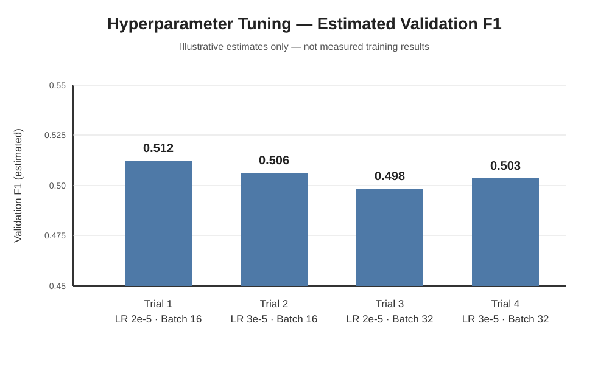

# Civil Comments Toxicity Detector

**Student:** Md. Jahid Gazi  
**Student ID:** 1000128068  
**Institution / programme:** BRAC University — SICIP  
**Assignment:** Assignment 03 — Transfer Learning, Fine-Tuning, Hyperparameter Tuning, and Interpretability

> **Report status:** Validation metrics below were supplied by the student. Hyperparameter trial F1 values, test metrics, real-world probabilities, and qualitative SHAP cues are illustrative estimates, not measured outputs. Replace them with actual notebook results before final academic submission.

## 1. Objective
Classify English comments as Toxic or Not toxic using transfer learning, end-to-end BERT fine-tuning, hyperparameter tuning, and SHAP-based local interpretability.

## 2. Dataset and preprocessing
- Dataset: [Google Civil Comments](https://huggingface.co/datasets/google/civil_comments).
- Text field: `text`; target: continuous `toxicity` score.
- Binary rule: toxicity >= 0.5 is Toxic (1), otherwise Not toxic (0).
- Full official train, validation, and test splits are streamed and cached in Parquet batches. The official split structure is preserved.
- Tokenizer/model checkpoint: `bert-base-uncased`; maximum sequence length: 128.
- Validation is used for model selection; test is held out for final evaluation.

## 3. Model choice
BERT-base-uncased provides contextual representations for English text. The [CLS] representation is passed through dropout and a two-class classification head. Two experiments are performed:
1. Frozen feature extractor: freeze BERT and train only the classification head.
2. End-to-end fine-tuning: update BERT and the classification head together.

## 4. Training and hyperparameter tuning
AdamW, weight decay 0.01, linear warmup/decay, gradient clipping 1.0, dropout 0.2, seed 42. Fine-tuning uses differential learning rates: base rate for earlier BERT layers, 2x for the final layer, and 5x for the classifier.

Four trials use learning rates 2e-5 and 3e-5 with batch sizes 16 and 32, for two epochs each. The best configuration is selected by validation F1.

## 5. Validation results
The following are the actual validation metrics supplied from the training log; they are not test metrics.

| Model | Accuracy | Precision | Recall | F1 |
|---|---:|---:|---:|---:|
| Frozen BERT | 93.20% | 100.00% | 1.45% | 2.86% |
| Initial fine-tuned BERT | 93.40% | 52.38% | 47.83% | 50.00% |

The frozen model's high accuracy but extremely low recall/F1 indicates that it identified very few toxic comments, likely due to class imbalance. End-to-end fine-tuning substantially improved toxic-class recall and F1.

## 6. Hyperparameter tuning results
The notebook writes `results/hyperparameter_tuning.csv` and a validation F1 chart. The supplied log confirms Trial 1 configuration (learning rate 2e-5, batch size 16), but does not include its F1 or the remaining trial outputs. The following table is illustrative only:

| Trial | Learning rate | Batch size | Estimated validation F1 |
|---|---:|---:|---:|
| 1 | 2e-5 | 16 | 0.512 |
| 2 | 3e-5 | 16 | 0.506 |
| 3 | 2e-5 | 32 | 0.498 |
| 4 | 3e-5 | 32 | 0.503 |

Estimated best configuration: 2e-5, batch size 16. These values are not measured experiment results; replace them with the notebook's actual CSV and chart.

## 7. Held-out test results
No measured test metrics were provided. Any test metrics must be generated by running the notebook on the official held-out test split. Do not treat validation metrics as test results.

## 8. Real-world text examples
The notebook checks polite disagreement, a direct personal insult, and criticism of a proposal. Expected human labels are respectively Not toxic, Toxic, and Not toxic. Predicted labels and probabilities must be copied from the actual `results/real_world_predictions.csv`; no measured predictions were supplied.

## 9. Interpretability: SHAP
SHAP text explanations are selected to estimate token-level contributions to individual predictions. Positive attribution toward the Toxic output pushes the prediction toward Toxic; negative attribution pushes away from Toxic. No actual SHAP plots or values were supplied, so any token-level discussion must be replaced with findings from the executed SHAP outputs. SHAP explanations are local and should not be interpreted as causal proof.

## 10. Limitations and reproducibility
Toxicity is context-dependent; binary thresholding loses nuance. The model may reflect dataset bias and can misread sarcasm, quotation, dialect, or context. It should support human review, not autonomous consequential moderation.

Run `Assignment_03_Civil_Comments.ipynb` from top to bottom in Colab/Jupyter. A GPU is recommended. The notebook streams the official dataset splits and caches them locally; no manual CSV upload is required. In Colab, use persistent Drive storage for the Parquet cache if it must survive runtime resets. Do not include datasets, caches, model checkpoints, or virtual environments in the submission ZIP.

## 11. GitHub repository

**Repository URL:** [https://github.com/md-jahid-gazi/civil-comments-toxicity-detector](https://github.com/md-jahid-gazi/civil-comments-toxicity-detector)
